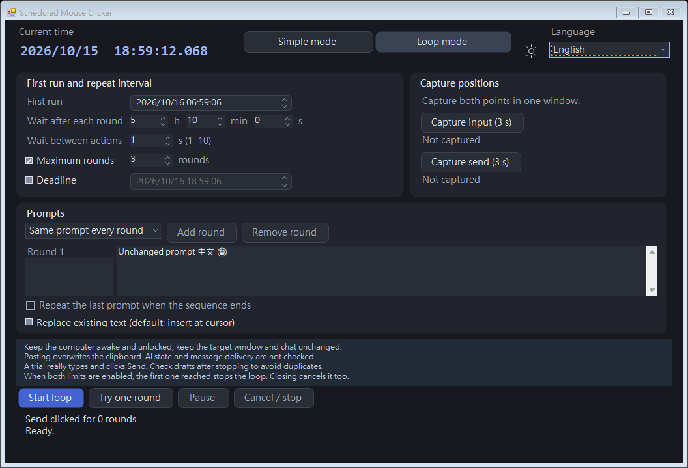
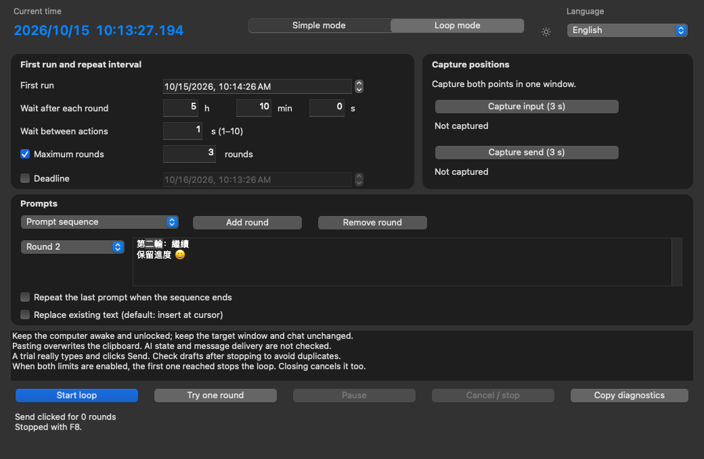

# ScheduledClicker — scheduled clicks and prompt loops for Windows & macOS

**Latest stable: v1.2.0 · October 15, 2026.** Free, open-source local desktop automation for Windows 11 and macOS 13+.

| Platform | App download | Checksum |
|---|---|---|
| Windows 11 | [ScheduledClicker.exe](https://github.com/HaNa-486/ScheduledClicker/releases/download/v1.2.0/ScheduledClicker.exe) | [Windows SHA-256](https://github.com/HaNa-486/ScheduledClicker/releases/download/v1.2.0/ScheduledClicker-Windows.sha256) |
| macOS 13+, Apple silicon + Intel | [Universal app ZIP](https://github.com/HaNa-486/ScheduledClicker/releases/download/v1.2.0/ScheduledClicker-macOS-universal.zip) | [Mac SHA-256](https://github.com/HaNa-486/ScheduledClicker/releases/download/v1.2.0/ScheduledClicker-macOS-universal.sha256) |

No GitHub sign-in required. The `.sha256` files are text checksums, not installers. [Installation help](https://hana-486.github.io/ScheduledClicker/download/) · [Release notes](https://github.com/HaNa-486/ScheduledClicker/releases/tag/v1.2.0) · [Website](https://hana-486.github.io/ScheduledClicker/)

Website guides: [English](https://hana-486.github.io/ScheduledClicker/) · [繁體中文](https://hana-486.github.io/ScheduledClicker/zh-Hant/) · [日本語](https://hana-486.github.io/ScheduledClicker/ja/) · [한국어](https://hana-486.github.io/ScheduledClicker/ko/) · [Deutsch](https://hana-486.github.io/ScheduledClicker/de/)

## Two modes, one window

- **Simple mode:** one single or double click at an exact future time or after a monotonic delay.
- **Loop mode:** input the same prompt every round or a sequence, click Send, then wait after the round completes. Set maximum rounds, a deadline, or both. Trial, pause/resume between rounds, cancel and F8 are available.
- A shared live clock, language selector, mode switch and always-visible notices.
- Traditional Chinese, English, Japanese, Korean and German. Startup follows the system language; Chinese locales use Traditional Chinese, ja/ko/de use their matching language, other locales use English. Manual switching works in both modes.
- The untouched starter prompt follows the selected language. User-edited prompts stay unchanged.
- Startup follows the system light/dark appearance; the sun/moon action changes both modes for the current session.
- Mac numeric duration, action-delay and round fields support mouse wheel/trackpad adjustment. Mac loops use AX hit-window capture and include copyable diagnostics.

These automated renders show the accepted v1.2.0 interface, not proof of message delivery. [Loop setup guide](https://hana-486.github.io/ScheduledClicker/recurring-input/)

## Install and try

**Windows:** download the portable EXE and follow the [Windows opening instructions](https://hana-486.github.io/ScheduledClicker/download/#install-windows). This unsigned build may trigger an unfamiliar-publisher warning. Malware or managed-device blocks require a different response; do not disable protection.

**Mac:** extract the universal ZIP, move ScheduledClicker.app to Applications and follow the [Mac installation and Accessibility guide](https://hana-486.github.io/ScheduledClicker/download/#install-macos). The app is ad-hoc signed, not Developer ID signed or notarized. The guide distinguishes unidentified-developer warnings from malware or damaged-file alerts. The accepted runtime is build12004; Apple silicon and Intel use the same ZIP.

[Verify the EXE with PowerShell](https://hana-486.github.io/ScheduledClicker/download/#verify-windows) or [verify the ZIP with Terminal](https://hana-486.github.io/ScheduledClicker/download/#verify-macos). These instructions explain full file paths, the 64-character comparison and what to do if the checksum differs. A matching checksum verifies bytes, not trusted authorship.

Start with a harmless simple click, then a trial with disposable text. Capture both loop positions in the same visible target window. Keep the computer awake and unlocked and the target layout unchanged.

[Report a problem](https://github.com/HaNa-486/ScheduledClicker/issues) with OS/app version, target app, steps and error text. Posting requires a GitHub account. Review Mac diagnostics before sharing; omit private prompts, conversations and personal paths. [Verification record](VERIFICATION.md) · [Mac acceptance guide](macOS/TESTING.md)

## Input, timing and privacy

Loop mode overwrites the clipboard and does not restore it. Text may remain in clipboard history or the target app. Simple mode does not use the clipboard; manually copying Mac diagnostics also replaces it. No schedules or prompts are saved by ScheduledClicker after exit. The app has no network access, accounts, telemetry or third-party packages.

The interval begins after each round completes, not at a provider quota-reset time. Pause resumes only during the between-round wait; pausing mid-round stops. Deadlines remain active while paused. Cancel/F8/close prevents remaining steps but cannot undo completed paste or clicks. Inspect drafts before restarting.

Window checks cannot recognize a changed chat or prove delivery. The app does not detect AI completion, bypass/reset/increase usage limits, or inspect your Codex account. It is independent of OpenAI. [Security notes](SECURITY.md)

## Verification and building

The owner accepted Mac normal functionality and the Windows prompt-language/custom-text/loop checks, then authorized this release. CI checks both native builds, scheduling, capture/focus policies, languages, layout and packaging. Evidence is scoped to tested behavior; it does not guarantee every third-party app, display combination or failure case.

- Windows: run `./build.ps1` in PowerShell. Uses the Windows .NET Framework compiler; output is `dist/ScheduledClicker.exe`.
- Mac: run `bash ./build-macos.sh` on a Mac with Xcode Command Line Tools. Produces an arm64/x86_64 universal app ZIP and checksum.
- Translations: edit `localization/ui.tsv`, then run `python scripts/generate-localization.py`; `--check` checks generated catalogs.
- Website: edit `site/content/*.json`, then run `python scripts/generate-site.py`. `--check`, `./scripts/validate-site.ps1` and `python scripts/validate-discovery.py` verify all 45 static pages, reciprocal language links, install anchors, localized metadata, downloads and visible FAQ/schema parity. See [site maintenance](site/README.md).

[Changelog](CHANGELOG.md) · [MIT License](LICENSE)

## 繁體中文

**最新正式版 v1.2.0** 同時支援 Windows 與 macOS。簡單模式可指定時間或倒數點擊；循環模式可定時貼上相同提示詞或依輪次輸入不同內容，再點擊送出。提供輪數／截止時間限制、試跑、暫停、停止、五語系及深淺色切換。

Windows 下載 EXE；Mac 下載通用 ZIP，解壓縮後將 App 移至「應用程式」並授予輔助使用權限。兩個正式下載都不需登入 GitHub；不要把 SHA-256 校驗檔當成安裝程式。

執行期間請保持電腦喚醒、不鎖屏，並固定目標視窗與聊天。循環會覆寫剪貼簿，取消無法撤回已輸入的內容。程式不判斷 AI 是否完成、額度是否恢復或訊息是否送達，也不會繞過任何使用限制。
